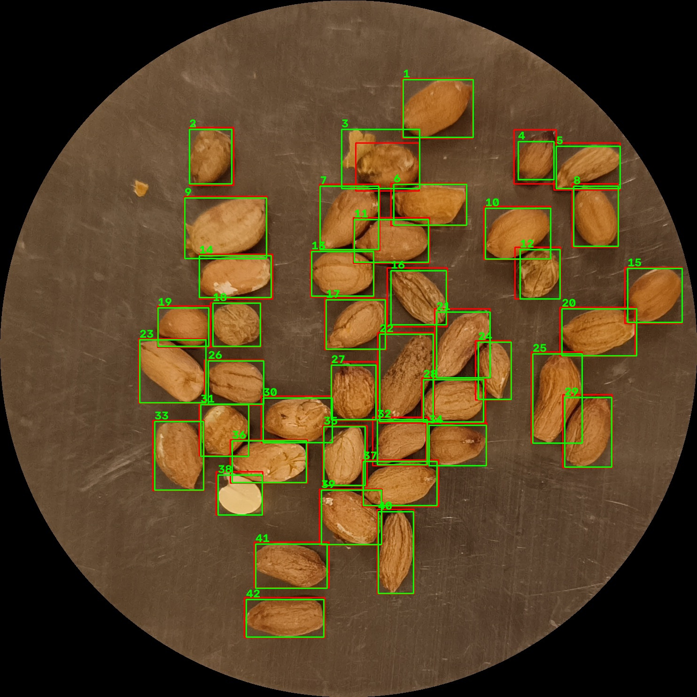
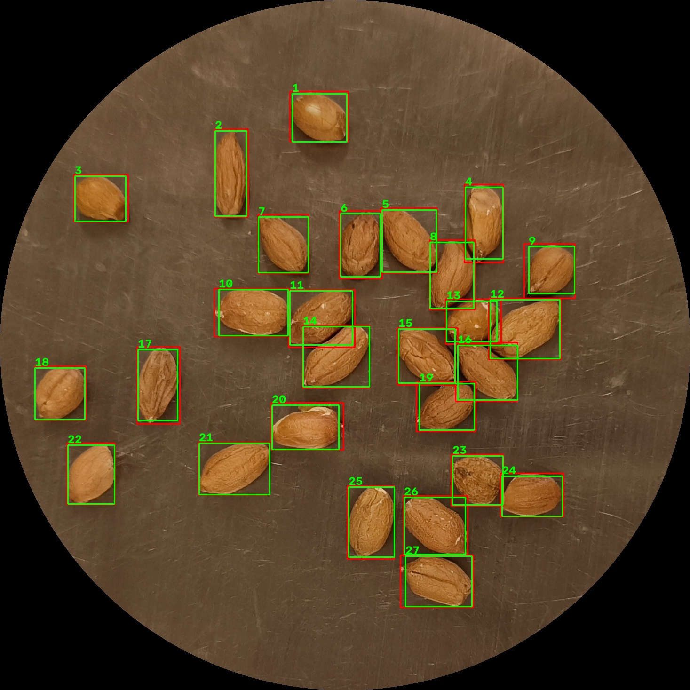
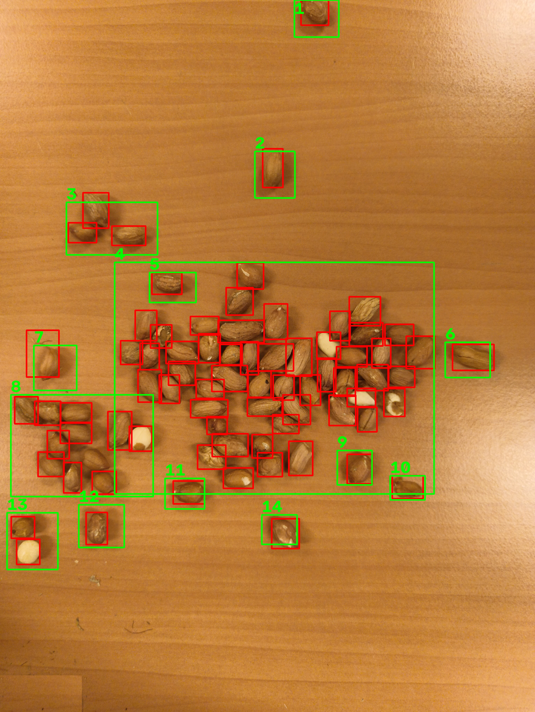
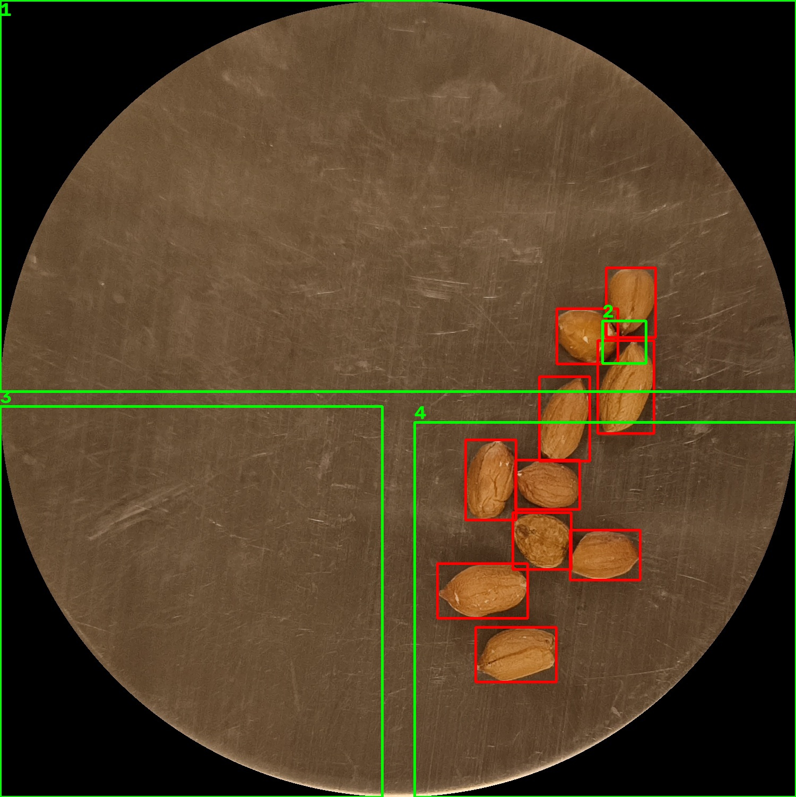

# Relatório técnico

# Relatório técnico — Inspeção e quantificação de amendoins com OpenCV

**Disciplina:** Processamento Gráfico
**Integrantes:** Cícero Calsing, Leonardo kuhn, Kauan Gross
**Data:** 18/11/2026

## 1. Problema e base de dados

- **Combinação sorteada:** 2 — Tema 1 (Inspeção e quantificação de grãos e sementes), subtema
  Amendoim: detectar, contar e medir os objetos da classe `peanuts` (id 1).
- **Base:** Grain Detection Dataset (Hugging Face, `niru-5/manama_course_dataset_grain_detection`),
  licença CC BY-NC 4.0.
- **Parte utilizada:** fotografias completas das divisões de validação e teste que contêm a classe
  `peanuts`, com as anotações COCO (`val_photos.json` e `test_photos.json`).

| Divisão | Fotos | Amendoins anotados | Fundo escuro (prato) | Fundo de madeira | Uso |
|---|---|---|---|---|---|
| val  | 11 | 191 | 9 | 2  | ajuste de parâmetros e escolha da configuração |
| test | 11 | 344 | 1 | 10 | avaliação final (executada uma única vez) |

As anotações foram usadas somente para avaliar os resultados, nunca como entrada da detecção.
As fotos de fundo escuro têm cerca de 1500×1500 px e os cantos recortados em preto. As de
madeira têm 3072×4080 px, textura de veios, reflexo de luz e sombras.

## 2. Pipeline

Para cada foto: **leitura → segmentação → rotulagem de componentes conexos → medição e filtro
de área → avaliação → desenho e tabelas**.

### 2.1 Segmentação

O tipo de fundo é detectado automaticamente pelos cantos da foto (`tem_fundo_escuro`). Caso detecte uma grande
quantidade de pixeis escuros ele decidia utilizar a função de fundo escuro, caso contrário decide utilizar a função para
o fundo de madeira.

**Fundo escuro (prato):**
1. Conversão para LAB com remoção do canal alpha e uso do canal **b** (azul ↔ amarelo), suavizado com gaussiano 7×7. O
   amendoim é amarelado e o prato é neutro, então o canal b separa os amendoins sem depender da
   iluminação.
2. **Otsu calculado só na região de interesse** (pixels que não são o preto dos cantos). Com os
   cantos incluídos, o Otsu separava "preto × prato" em vez de "prato × amendoim".
3. **Remoção de sombras** entre grãos encostados: pixels mais escuros de uma média local que a média geral
   por mais de um valor de 10 níveis são apagados, o que abre uma fenda entre os grãos.
5. **Morfologia** com elipse 5×5: abertura (2 iterações) para remover ruído e fechamento
   (1 iteração) para tapar buracos.

**Fundo de madeira:** a cor do amendoim é praticamente igual à da madeira (canal b de 169 a 173),
então a separação usa **bordas**:
1. Redução da foto para 1000 px de largura (só nesta etapa), conversão para o padrão LAB e aplicação de mediana,
   o que apaga os veios finos da madeira e preserva as bordas fortes dos grãos.
2. **Magnitude do gradiente de Sobel** (x e y) com limiar 20.
3. É efetuado um contraste de borda e de fundo em separados, criando duas máscaras diferentes.
4. Efetuado bitwise para alterar as cores e floodfill para espalhar o resultado para o fundo inteiro.
5. Por fim, é realizadao uma morfologia de abertura com elipse 25x25 em sincronia com a junção das máscaras de borda e fundo.

### 2.2 Medição e filtro de área

Para cada componente: área, caixa delimitadora (x, y, largura, altura), razão de aspecto (lado
maior ÷ lado menor), centro de massa e preenchimento (área ÷ área da caixa). Componentes com área
menor que 1000 px são descartados como ruído. A contagem final é o número de componentes que
passam pelo filtro.

### 2.3 Saídas

- `resultados/<divisao>_<config>_conectividade<4|8>/imagens/`: gabarito em vermelho e detecções
  em verde, numeradas;
- `resumo.csv`: uma linha por foto (contagem, VP, FP, FN, F1, causas dos erros, tempos);
- `medicoes.csv`: uma linha por amendoim (área, caixa, aspecto, preenchimento, centro, IoU);
- `resultados/experimento/`: tabelas comparativas e validação da rotulagem.

### 2.4 Arquivos da avaliação em test

A avaliação final foi gerada uma única vez, com os parâmetros congelados, pelo comando
`python src/main.py --divisao test --experimento`. Ela produziu dois conjuntos de arquivos.

**Uma pasta por execução:** `resultados/test_<config>_conectividade<4|8>/`, ou seja, 8 pastas
(C0 a C3 × conectividade 4 e 8). Cada uma contém:

| Arquivo | Conteúdo | Linhas |
|---|---|---|
| `resumo.csv` | Uma linha por foto: tamanho, tipo de fundo, componentes brutos, contados × gabarito, erro de contagem, VP, FP, FN, precisão, revocação, F1, IoU médio, causas dos erros e tempo de cada etapa | 11 |
| `medicoes.csv` | Uma linha por amendoim detectado: número, área, caixa (x, y, largura, altura), aspecto, preenchimento, centro, se casou com o gabarito (`correta`) e o IoU | de 176 (C2) a 472 (C0 c4) |
| `imagens/` | Cada foto com o gabarito em vermelho e as detecções em verde, numeradas como em `medicoes.csv`. Só há imagens nas pastas da C2 e da C3 (`CONFIGURACOES_COM_IMAGENS` em `experimento.py`). As da C0 e da C1 têm só os CSVs | 11 |

**Tabelas consolidadas** em `resultados/experimento/`:

| Arquivo | Conteúdo | Linhas |
|---|---|---|
| `test_comparacao.csv` | Uma linha por configuração × conectividade × fundo (todos, escuro, madeira). Soma VP, FP, FN e as causas dos erros sobre as fotos do grupo e informa precisão, revocação, F1, se o critério F1 ≥ 0,80 foi atingido, MAE da contagem, componentes brutos e tempo médio por etapa. É a origem das tabelas 5.2 a 5.5 | 24 |
| `test_por_foto.csv` | Todas as linhas de `resumo.csv` das 8 execuções reunidas em um só arquivo | 88 |
| `test_rotulagem.csv` | Uma linha por foto × máscara (C1, C2) × conectividade. Compara a rotulagem manual com `cv2.connectedComponents` (número de componentes, partição idêntica, tempo de cada uma). É a origem das tabelas da seção 3 | 44 |

Os arquivos `val_*` e as pastas `resultados/val_*` têm a mesma estrutura e foram gerados com
`--divisao val`, durante o ajuste dos parâmetros.

## 3. Componente algorítmico: rotulagem de componentes conexos

Implementação manual em `src/rotulagem.py`, com o **algoritmo de duas passagens e tabela de
equivalências (union-find)**:

1. **Primeira passagem:** varredura linha a linha. Cada pixel de objeto olha os vizinhos já
   visitados: ↑ e ← na **conectividade 4**; ↖ ↑ ↗ e ← na **conectividade 8**. Sem vizinho
   rotulado, recebe um rótulo novo. Com vizinhos, recebe o menor rótulo, e rótulos diferentes
   são registrados como equivalentes (`unir`).
2. **Union-find com compressão de caminho:** `encontrar_raiz` sobe até a raiz e faz todos os
   rótulos do caminho apontarem direto para ela. A raiz de cada grupo é sempre o menor rótulo.
3. **Segunda passagem:** uma tabela (como a LUT da Aula 8) converte cada rótulo provisório no
   número final do objeto e é aplicada na matriz inteira de uma vez com indexação do NumPy.

As duas conectividades ficam em funções separadas (`rotular_conectividade_4` e
`rotular_conectividade_8`), que compartilham as funções de união, rotulagem do pixel e
consolidação. A escolha é feita por `rotular_componentes_conexos(mascara, conectividade)`.

**Validação:** a rotulagem foi comparada com `cv2.connectedComponents` em todas as máscaras
reais, nas configurações C1 (sem morfologia, com milhares de componentes) e C2, com conectividade
4 e 8. A comparação verifica a **partição** dos pixels, e não os números dos rótulos, porque o
OpenCV numera os objetos em outra ordem.

| Divisão | Máscaras comparadas | Resultado idêntico |
|---|---|---|
| val  | 44 | 44 |
| test | 44 | 44 |

**Tempo médio por foto** (rotulagem manual × OpenCV):

| Divisão | Máscara | Conect. | Componentes (total) | Manual | OpenCV | Razão |
|---|---|---|---|---|---|---|
| val  | C2 | 4 | 188    | 0,44 s | 0,005 s | ~80×  |
| val  | C2 | 8 | 186    | 0,56 s | 0,004 s | ~140× |
| test | C2 | 4 | 177    | 1,51 s | 0,016 s | ~100× |
| test | C2 | 8 | 177    | 2,10 s | 0,011 s | ~200× |
| test | C1 | 8 | 21.944 | 9,99 s | 0,012 s | ~840× |

A implementação em Python puro é de 80 a 840 vezes mais lenta que a do OpenCV, que é escrita
em C++ otimizado. O custo cresce com o número de pixels de objeto e de componentes: máscaras
ruidosas (C1) e fotos grandes (test) são as mais lentas. A conectividade 8 custa mais que a 4
porque examina 4 vizinhos em vez de 2.

## 4. Investigação experimental

### 4.1 Pergunta e hipóteses

**Pergunta:** é possível distinguir os amendoins individualmente usando apenas filtros clássicos?

**Definição de "distinguir":** um amendoim anotado é distinguido quando existe uma caixa do
programa só dele com IoU ≥ 0,5 (casamento guloso um-para-um). A métrica principal é o **F1 por
localização**, e não a contagem: a contagem pode sair certa com as caixas erradas.

**Critério de sucesso, definido antes dos experimentos:** F1 ≥ 0,80 em cada tipo de fundo
(`CRITERIO_F1` em `config.py`).

- **H1:** nas fotos de fundo escuro uniforme, o pipeline atinge F1 ≥ 0,80.
- **H2:** nas fotos de madeira, o F1 fica abaixo de 0,80 (textura, sombras e brilho do fundo).
- **H3:** a principal causa de erro restante são grãos encostados que viram um componente só.
- **H4:** com morfologia, a conectividade 4 ou 8 não altera o resultado; sem morfologia, a
  conectividade 4 fragmenta mais.

### 4.2 Configurações comparadas (estudo de ablação)

Cada configuração acrescenta uma etapa à anterior:

| Config. | Descrição |
|---|---|
| C0 | Limiar simples: cinza + Otsu global (objeto = classe com menos pixels) |
| C1 | Cor + região de interesse: Otsu no canal adequado a cada fundo, sem morfologia |
| C2 | Método completo de cada fundo: C1 + sombras/bordas + morfologia (pipeline principal) |
| C3 | C2 + separação de grãos encostados (transformada de distância + watershed, só nos componentes com área > 1,6 × a mediana) |

Cada configuração foi executada com conectividade 4 e 8.

### 4.3 Protocolo

1. Critério e hipóteses definidos antes dos experimentos.
2. Parâmetros e configuração oficial escolhidos **somente em val**. A regra de escolha foi o maior
   F1 total em val, e ela indicou a **C2** (0,871 contra 0,870 da C3).
3. Parâmetros congelados.
4. Test executado **uma única vez**, com todas as configurações.

### 4.4 Métricas

- **Por localização (IoU ≥ 0,5):** VP, FP, FN, precisão, revocação e F1 (média micro: VP, FP e FN
  somados sobre as fotos).
- **Por contagem:** erro por foto e erro absoluto médio (MAE).
- **Causas dos erros**, a partir do centro das caixas anotadas: FP *fusão* (caixa com 2 ou mais
  amendoins), FP *imprecisa* (sobre 1 amendoim, mas com IoU < 0,5), FP *espúria* (sobre nenhum
  amendoim); FN *fundido*, FN *caixa imprecisa*, FN *não detectado*.
- **Tempo** por etapa (segmentação, rotulagem, medição).

## 5. Resultados

### 5.1 Validação (conectividade 8)

| Config. | Fundo | VP | FP | FN | Precisão | Revocação | F1 | F1 ≥ 0,80 |
|---|---|---|---|---|---|---|---|---|
| C0 | escuro  | 3   | 50 | 151 | 0,057 | 0,019 | 0,029 | não |
| C0 | madeira | 0   | 66 | 37  | 0,000 | 0,000 | 0,000 | não |
| C1 | escuro  | 146 | 2  | 8   | 0,987 | 0,948 | 0,967 | sim |
| C1 | madeira | 2   | 40 | 35  | 0,048 | 0,054 | 0,051 | não |
| C2 | escuro  | 152 | 1  | 2   | 0,994 | 0,987 | **0,990** | sim |
| C2 | madeira | 10  | 18 | 27  | 0,357 | 0,270 | **0,308** | não |
| C3 | escuro  | 154 | 0  | 0   | 1,000 | 1,000 | 1,000 | sim |
| C3 | madeira | 10  | 22 | 27  | 0,312 | 0,270 | 0,290 | não |
| **C2** | **todos** | 162 | 19 | 29 | 0,895 | 0,848 | **0,871** | sim |

### 5.2 Teste (conectividade 8, parâmetros congelados)

| Config. | Fundo | VP | FP | FN | Precisão | Revocação | F1 | F1 ≥ 0,80 |
|---|---|---|---|---|---|---|---|---|
| C0 | escuro  | 0  | 17  | 42  | 0,000 | 0,000 | 0,000 | não |
| C0 | madeira | 24 | 420 | 278 | 0,054 | 0,080 | 0,064 | não |
| C1 | escuro  | 30 | 5   | 12  | 0,857 | 0,714 | 0,779 | não |
| C1 | madeira | 13 | 228 | 289 | 0,054 | 0,043 | 0,048 | não |
| C2 | escuro  | 42 | 0   | 0   | 1,000 | 1,000 | **1,000** | sim |
| C2 | madeira | 52 | 82  | 250 | 0,388 | 0,172 | **0,239** | não |
| C3 | escuro  | 42 | 1   | 0   | 0,977 | 1,000 | 0,988 | sim |
| C3 | madeira | 57 | 124 | 245 | 0,315 | 0,189 | 0,236 | não |
| **C2** | **todos** | 94 | 82 | 250 | 0,534 | 0,273 | **0,361** | não |

**Contagem (C2, conectividade 8):** em val, 181 contados para 191 anotados (MAE 0,91 por foto,
8 de 11 fotos exatas). Em test, 176 contados para 344 anotados (MAE 15,3 por foto).

**Atenção à comparação val × test:** o F1 total cai de 0,871 para 0,361 porque val tem 9 fotos
de fundo escuro e 2 de madeira, enquanto test tem 1 de fundo escuro e 10 de madeira. Por tipo de
fundo, o desempenho se mantém: fundo escuro 0,990 → 1,000; madeira 0,308 → 0,239.

### 5.3 Conectividade 4 × 8

| Divisão | Config. | Componentes brutos (c4) | Componentes brutos (c8) | F1 (c4) | F1 (c8) |
|---|---|---|---|---|---|
| val  | C0 | 179.884 | 125.815 | 0,026 | 0,019 |
| val  | C1 | 5.398   | 5.336   | 0,779 | 0,777 |
| val  | C2 | 188     | 186     | 0,871 | 0,871 |
| test | C0 | 968.425 | 698.920 | 0,054 | 0,060 |
| test | C2 | 177     | 177     | 0,361 | 0,361 |

### 5.4 Causas dos erros (C2, conectividade 8)

| Divisão | Fundo | FP fusão | FP imprecisa | FP espúria | FN fundido | FN caixa imprecisa | FN não detectado |
|---|---|---|---|---|---|---|---|
| val  | escuro  | 1  | 0  | 0 | 2   | 0  | 0 |
| val  | madeira | 6  | 11 | 1 | 16  | 11 | 0 |
| test | escuro  | 0  | 0  | 0 | 0   | 0  | 0 |
| test | madeira | 26 | 47 | 9 | 201 | 45 | 4 |

Nas caixas que contêm um único amendoim, a razão entre a área da caixa detectada e a da caixa
anotada (mediana) é de 0,91 no fundo escuro e de 1,81 a 1,91 na madeira.

### 5.5 Tempo de processamento (média por foto, conectividade 8)

| Divisão | Config. | Segmentação | Rotulagem | Medição | Total |
|---|---|---|---|---|---|
| val  | C2 | 0,05 s | 0,59 s  | 0,16 s | 0,79 s  |
| val  | C3 | 0,88 s | 0,59 s  | 0,16 s | 1,63 s  |
| test | C1 | 0,37 s | 13,72 s | 0,98 s | 15,07 s |
| test | C2 | 0,11 s | 3,54 s  | 0,72 s | 4,36 s  |
| test | C3 | 3,35 s | 2,25 s  | 0,57 s | 6,16 s  |

A rotulagem manual domina o tempo do pipeline. As fotos de test (12 megapixels) são de 5 a 6
vezes mais lentas que as de val.

## 6. Discussão

### 6.1 Hipóteses

- **H1 — confirmada.** No fundo escuro, a C2 atinge F1 = 0,990 em val e 1,000 em test (42 de 42
  amendoins). A ressalva é que test tem uma única foto de fundo escuro.
- **H2 — confirmada.** Na madeira, nenhuma configuração passa de 0,31 (val) ou 0,24 (test).
- **H3 — confirmada em parte.** Grãos fundidos são a principal causa de **amendoins perdidos**
  (test, madeira: 201 de 250 FN). Já os **falsos positivos** da madeira vêm principalmente de
  **caixas imprecisas** (47 de 82): as caixas de um amendoim só saem com cerca de 1,8× a área da
  anotação, pela faixa de borda do Sobel e pela abertura com elipse grande. A separação por
  transformada de distância (C3) resolveu a única fusão do fundo escuro em val, mas não
  generalizou: em test cortou um amendoim do fundo escuro e não separou os montes da madeira.
- **H4 — confirmada.** Com morfologia (C2 e C3), as duas conectividades dão o mesmo F1.
  Sem morfologia, a conectividade 4 gera de 30% a 40% mais componentes brutos (C0), porque
  separa regiões ligadas só pela diagonal. A diferença no F1 é pequena e só aparece nas
  configurações sem morfologia.

### 6.2 Ablação: o que cada etapa acrescenta

- **C0 → C1:** a etapa decisiva. Um Otsu global no cinza detecta os cantos pretos da foto (o
  grupo com menos pixels) e não os amendoins. Escolher o canal de cor certo e restringir o Otsu
  à região de interesse eleva o F1 do fundo escuro de 0,03 para 0,97 em val.
- **C1 → C2:** a remoção de sombras e a morfologia corrigem grãos encostados e ruído (F1 de
  0,967 → 0,990 em val e 0,779 → 1,000 em test, no fundo escuro). Também deixam o pipeline mais
  rápido: os componentes brutos caem de milhares para centenas.
- **C2 → C3:** sem ganho consistente. Melhora o fundo escuro em val, mas piora levemente em test.

### 6.3 Onde o método funciona

*Figura 1 — Test, peanuts_0027 (C2, conectividade 8): fundo escuro, 42 de 42 amendoins detectados, F1 = 1,00, IoU médio 0,90.*

*Figura 2 — Val, peanuts_0039 (C2, conectividade 8): fundo escuro, 27 de 27 amendoins detectados, F1 = 1,00, IoU médio 0,90.*

Fundo uniforme e de cor diferente do amendoim, iluminação homogênea e grãos espalhados ou com
pouco contato: as caixas coincidem com as anotações (IoU médio ≈ 0,90).

### 6.4 Onde o método falha

*Figura 3 — Test, peanuts_0009 (C2, conectividade 8): madeira com 75 amendoins, a maioria encostados; 14 regiões detectadas, 70 amendoins perdidos (F1 = 0,11).*

*Figura 4 — Val, peanuts_0018 (C0, conectividade 8): o Otsu global separa os cantos pretos do resto da foto; 4 regiões detectadas, nenhuma é amendoim (F1 = 0,00).*

1. **Caixas infladas na madeira (test 0034):** os 7 amendoins foram encontrados e a contagem saiu
   exata, mas só 1 caixa teve IoU ≥ 0,5. Este caso mostra por que a contagem sozinha não mede a
   qualidade da detecção.
2. **Montes de grãos (test 0009, 75 amendoins):** dezenas de grãos encostados viram uma única
   região; a separação por distância não encontra os pontos de corte. F1 = 0,11.
3. **Limiar ingênuo (C0):** sem região de interesse, o Otsu separa os cantos pretos do resto da
   foto, e o "objeto" detectado passa a ser os cantos.
4. **Reflexo de luz e sombras na madeira:** geram bordas falsas e regiões espúrias (9 FP
   espúrios em test).

## 7. Conclusão

Com apenas filtros clássicos, **é possível distinguir os amendoins quando o fundo é uniforme e
contrasta em cor com o grão**: no prato escuro, o pipeline atinge F1 entre 0,99 e 1,00 em val e
em test, acima do critério de 0,80. **Na madeira, não é possível com o método proposto**: o
fundo tem a mesma cor do amendoim, a separação depende de bordas, as caixas saem infladas e os
montes de grãos não são separados (F1 ≤ 0,31). A conclusão depende do tipo de fundo, e a escolha
do espaço de cor é a decisão mais importante do pipeline.

## 8. Limitações

- **Divisões desbalanceadas:** só 2 fotos de madeira em val (ajuste) contra 10 em test, e 1
  foto de fundo escuro em test. O ajuste para madeira foi feito com pouquíssimos dados, e a
  conclusão sobre o fundo escuro em test se baseia em uma única foto.
- **Escalas diferentes:** as fotos não foram padronizadas para o mesmo tamanho, então a área
  mínima (1000 px) representa frações diferentes de um grão em cada tipo de foto.
- **Tempo:** a rotulagem manual em Python é de 80 a 840 vezes mais lenta que a do OpenCV.
- **Detecção do fundo por regra fixa:** depende de as fotos de prato terem os cantos pretos.
- **Avaliação por caixa:** o IoU de caixas penaliza máscaras corretas com caixas um pouco maiores.

## 9. Referências

- KUKKALA, N. *Grain Detection Dataset*. Hugging Face, 2024. Licença CC BY-NC 4.0.
  https://huggingface.co/datasets/niru-5/manama_course_dataset_grain_detection
- Exemplos das Aulas 6, 7 e 8 da disciplina de Processamento Gráfico.
- OpenCV — documentação de `threshold` (Otsu), `morphologyEx`, `Sobel`, `distanceTransform`,
  `watershed` e `connectedComponents`. https://docs.opencv.org
- EVERINGHAM, M. et al. The PASCAL Visual Object Classes (VOC) Challenge. *International
  Journal of Computer Vision*, 2010 (critério IoU ≥ 0,5).
